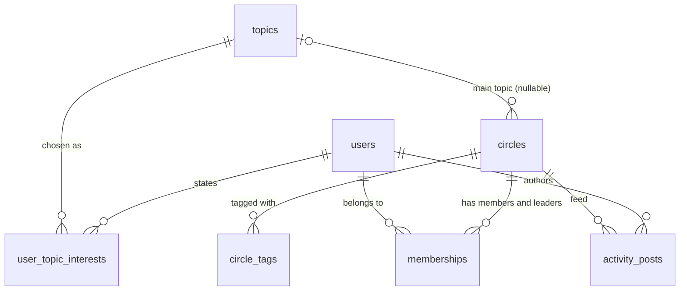

# Database schema

SQLite, defined in [`app/schema.sql`](../app/schema.sql) and loaded by `python -m app.seed`.
The API opens the database read only. Recommendations are a read path, so nothing on it can write.

## Relationships

- A **user** states many topic interests and belongs to many Circles. A **Circle** has many members, one or more of whom are leaders.
- A Circle has at most one **main topic** (two Circles have none) and any number of **tags**.
- **Activity posts** belong to one Circle and one author.

## Tables

| Table | Primary key | Columns worth noting |
|---|---|---|
| `topics` | `id`, `slug` UNIQUE | `label` for display, `domain`. Other tables reference `slug`, which is stable and readable. |
| `users` | `id` | Profile fields, `location`, `profile_completeness` (CHECK 0 to 1), `joined_at`. |
| `user_topic_interests` | (`user_id`, `topic_slug`) | Normalized from the JSON array. FK to `topics.slug`, so an interest can't name a topic that doesn't exist. |
| `circles` | `id`, `slug` UNIQUE | `topic_slug` nullable FK. `format`, `access`, `join_policy` with CHECK enums. `max_members` NULL means uncapped. Activity counters `member_count`, `feed_posts_30d`, `chat_messages_30d`, `last_activity_at`. |
| `circle_tags` | (`circle_id`, `tag`) | Normalized and deduplicated (the source repeats one tag). No FK to `topics`: tags are free text in a real product. |
| `memberships` | (`user_id`, `circle_id`) | `role` is `member` or `leader`. A leader is a member with a role, not a separate table. `joined_at` picks the primary leader. |
| `activity_posts` | `id` | `reaction_count`, `comment_count`, `save_count`, `created_at`. |
| `dataset_meta` | `key` | `reference_time`, the snapshot's "now" (its latest timestamp), written at seed time. |

## Indexes and the query each one serves

| Index | Query it serves |
|---|---|
| `circles(topic_slug)` | **Retrieval:** Circles whose main topic is one of the member's topics. |
| `circle_tags(tag)` | **Retrieval:** Circles carrying one of the member's interests as a tag. The primary key leads with `circle_id`, so it can't serve this lookup. |
| `circles(feed_posts_30d DESC, last_activity_at DESC) WHERE access = 'public'` | **Retrieval:** the popularity pool used for cold start and to fill short lists. The index order matches `ORDER BY ... LIMIT`, so SQLite reads the top rows and stops, with no sort. It is partial, so unlisted Circles never enter it. A test checks the query plan uses it. |
| `memberships` PK (`user_id`, `circle_id`) | The Circles a member is already in, which are excluded. The key also stops someone joining twice. |
| `memberships(circle_id, role)` | Leaders of the shortlisted Circles, without scanning every membership. |
| `activity_posts(circle_id, created_at)` | Engagement over the last 30 days: one range scan per shortlisted Circle. |
| `user_topic_interests` PK (`user_id`, `topic_slug`) | Load one member's interests. |
| `user_topic_interests(topic_slug)` | Reverse lookup, members interested in a topic. Not on the request path today. It is there for audience sizing and a future "members like you" signal. Drop it if that never ships. |

**Not indexed, on purpose:** `circles.access` and `circles.format` (two or three values each, so an index wouldn't narrow anything), and `users.location` (matching is done in memory for one user). Join tables are `WITHOUT ROWID` because the composite key is their only access path, which saves a second b-tree.

## Design decisions

- **Normalize the arrays** (`topic_interests`, `tags`) into join tables. "Circles on any of my topics" becomes an indexed join, and foreign keys catch misspelled topic slugs at load time.
- **Retrieve, then score.** A request loads only a shortlist: the union of the topic, tag and popularity indexes. Leaders and engagement are then fetched only for that shortlist. Id lists go in as one JSON array through `json_each`, so a long list never hits SQLite's parameter limit.
- **Keep the activity counters on `circles`**, as the product would, because they are cheap at ranking time. Engagement quality (interactions per post) is computed from `activity_posts`, because the counters don't capture it.
- **Derive "full", "inactive" and "leader" at query time** instead of storing flags that could drift from the data.
- **Timestamps as ISO 8601 UTC text** in one fixed format. In SQLite string order equals time order, so time ranges use the indexes.
- **CHECK constraints** on enums and counts, and `PRAGMA foreign_key_check` after loading, so bad data fails the seed instead of a request.
- **Atomic seeding.** The loader builds `recs.db.tmp`, validates it, runs `ANALYZE` so the planner has row counts, then swaps it in with `os.replace`. A failed load leaves the previous database untouched.
- **`ON DELETE CASCADE`** from users and Circles to their interests, tags and memberships, so deleting an account leaves no orphans. Posts keep a plain FK to their author, because removing content is a moderation decision, not a cascade.

## At production scale

- **Postgres** with read replicas for this read-heavy path. Interests and tags can stay as join tables, or become `text[]` with GIN indexes.
- **`circle_stats`** (a table or materialized view) refreshed from the event stream, holding activity, engagement and open spots. Ranking then never aggregates raw posts. The popularity index moves onto it.
- **Partition `activity_posts` by month** and keep only the recent window hot.
- **`recommendation_events`** (user, Circle, rank, shown/clicked/joined/dismissed, time), partitioned by time. It feeds offline evaluation, A/B tests and a learned ranker.
- **Location on Circles** (city plus a geo point with a spatial index) instead of borrowing the leader's.
- **Capacity under concurrency.** Joining should increment `member_count` with a conditional `UPDATE ... WHERE member_count < max_members`, so two members can't take the last spot.
